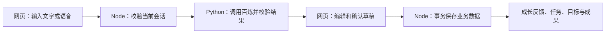

# 苹什么：AI 与现有网页接入说明

现在沿用仓库中的 React 网页和 Node/Fastify 业务后端，新增 Python/FastAPI AI 服务。业务数据只由 Node 保存。根目录外原来的 Python 原型保留作参考，不需要同时运行，也不参与这个网页的数据保存。



## 已接入的流程

- **种下方向**：300 字内的描述 → AI 提取方向与明确目标 → 修改、勾选 → 一次确认批量创建。目标默认手动完成，可改成数量或百分比目标；不猜测目标数量。
- **记录日常**：AI 拆分行动、计划、灵感、目标建议，并匹配自己的活跃项目。不能可靠匹配时保持未归类。分类、内容、项目和日期可在确认页修改。
- **确认后保存**：行动增加成长；计划保存为任务；灵感和目标建议保存为记录。目标建议不会创建或替换当前正式目标；正式目标在项目详情中明确创建。计划、灵感与情绪不会因 AI 识别就自动增加成长。
- **目标、任务、成果和报告**：复用 V0.2 业务规则，不建立第二套数据库。目标进度通过独立接口更新，行动不携带贡献数量；任务勾选、撤销和重复提交沿用现有规则。
- **AI 回顾**：报告统计仍由业务后端计算。点击按钮才生成回顾文案，同一会话、数据版本和周期缓存 10 分钟。文案需要人工检查，次数与进度以页面统计为准。
- **语音入口**：点击“点击说话”直接录音，再次点击结束，或取消录音。浏览器录音兼容 Safari MP4/AAC 和 WebM/Opus，发送前统一转换为 16 kHz 单声道 PCM WAV；转写后先修改文字，再进行 AI 整理。录音最长 60 秒。原音频仅用于转写请求，不保存到业务数据库。

**本地语音已经完成实际麦克风录音验证。** 选用免费额度列表中已有额度的 `qwen-audio-3.1-asr-flash`，用户已确认“用完即停”开启。新环境的 `.env.example` 默认关闭，需要确认额度后设置 `ASR_ENABLED=true`。浏览器直接录音要求 HTTPS 或 localhost；远程 HTTP 页面只能输入文字，需要 HTTPS 入口后才可直接录音。

此型号使用 DashScope 同步接口 `/api/v1/services/aigc/multimodal-generation/generation`，与文字模型的 `/compatible-mode/v1/chat/completions` 不同。服务自动使用同一业务空间域名，按音频实际格式传参并读取完整转写文本。`streaming`、`message`、`filetrans` 型号采用其他接入方式，不能直接替换名称。

## 启动

需要 Python 3.12+、Node 20.19+ 和项目指定的 pnpm。先安装 Node 依赖：

```powershell
pnpm install --frozen-lockfile
```

首次启动在 `apps/ai` 创建虚拟环境并安装依赖，将 `.env.example` 复制为 `.env`，填写模型配置。`apps/api/.env` 只需要模型服务地址和共享认证令牌，**不放百炼密钥**。

```powershell
cd apps/ai
python -m venv .venv
.\.venv\Scripts\python -m pip install -r requirements.txt
```

如果已经有填好的本地模型 `.env`，可以用以下命令导入配置，同时生成 Python 与 Node 之间的共享令牌。命令不会输出密钥，语音保持关闭。

```powershell
.\.venv\Scripts\python scripts/configure_local.py --from-env 你已填好的.env的完整路径
```

开两个终端：

```powershell
# 终端 1：在 apps/ai
.\.venv\Scripts\python -m uvicorn ai_service.main:app --host 127.0.0.1 --port 8002

# 终端 2：在仓库根目录，启动 Node 和网页
pnpm dev
```

默认网页入口 `http://localhost:5173`。若改用其他端口，请同步修改 `apps/api/.env` 的 `CORS_ORIGIN`。本次本地演示使用 `http://localhost:5174`，在 `apps/web` 运行 `pnpm exec vite --host 127.0.0.1 --port 5174`。

Python AI 服务监听 8002，Node 业务服务监听 3001。以前的 `http://127.0.0.1:8001/docs` 是旧原型的接口调试页；当前网页通过 Node 的 `/api/v1` 接口工作。

## 新增的网页接口

全部沿用 HttpOnly 匿名会话 Cookie。网页先通过 `POST /api/v1/session` 初始化会话，不直接调用 Python，不接触模型密钥。下表响应是 V0.2 信封中的 `data`，完整成功响应为 `{code:"OK",data:...,request_id:...}`，HTTP 字段统一使用 `snake_case`。

| 接口                                 | 请求                                                    | 响应与作用                                                               |
| ------------------------------------ | ------------------------------------------------------- | ------------------------------------------------------------------------ |
| `GET /api/v1/ai/capabilities`        | 无                                                      | `{ai_configured,asr_enabled}`                                            |
| `POST /api/v1/ai/projects/analyze`   | `{text}`，最多 300 字                                   | `{candidates:[{name,goal_text,source_text}]}`，只生成草稿                |
| `POST /api/v1/ai/records/analyze`    | `{text,source:"text"或"voice"}`，最多 2000 字           | `{items:[{client_item_id,content,type,project_id,emotion,source_text}]}` |
| `POST /api/v1/ai/reports/summarize`  | `{period:"7天"}`，也支持 30天、本月、全部               | `{summary}`，数据由后端读取                                              |
| `POST /api/v1/asr/transcribe`        | `{audio_base64,mime_type}`                              | `{text}`，关闭语音时返回明确错误                                         |
| `POST /api/v1/projects/batch`        | `{projects:[{client_item_id,name,icon?,color?,goal?}]}` | 批量方向及用户确认的初始正式目标在一次事务中保存                         |
| `POST /api/v1/record-batches/commit` | `{raw_text,source,items:[...]}`                         | 用户确认后保存记录或任务，沿用 V0.2 幂等与事务规则                       |

项目上下文由 Node 从当前会话中读取，不接受网页传来的项目列表作为权限依据。记录和方向的原文片段必须能在输入中找到。行动、计划、目标建议保留识别原文与可选情绪，语音记录保留 `source=voice`。AI 结果仍可能有语义误判，所以确认页是必经步骤。两类批量保存接口需要 `Idempotency-Key`；仅生成草稿的 AI 接口不需要，重复分析会再次调用模型。

每个会话一分钟最多 10 次 AI/转写请求。文字模型关闭深度思考，输出上限 1536 token。模型失败不自动重试；保留原文并提供手动整理。空报告不调用模型。API 限频在当前进程内生效，正式多实例部署应换为共享限频存储。

## 测试与协作

```powershell
# 仓库根目录：类型、规范、格式、测试与构建
pnpm check

# apps/ai：另装 pytest 后运行模拟测试，不消耗模型额度
.\.venv\Scripts\python -m pip install pytest==8.3.5
.\.venv\Scripts\python -m pytest tests -q
```

可以向同学这样说明分工：

> 我负责 Python AI 服务：自然语言拆分、成长方向提取、语音转写接口和模型结果校验，也把 AI 草稿接到现有网页。我已经接好 Node 到 Python 的调用。你继续维护网页体验和现有业务后端，包括项目、任务、目标、成果、报告及部署。正式数据统一由你的 Node 后端保存，AI 只提供候选草稿。

服务器部署见 [腾讯云部署说明](docs/tencent-cloud-deploy.md)。CI 同时检查 Node 与 Python，再打包 Python 运行源码；首次在服务器运行 `setup-ai.sh` 并填写服务器环境文件，之后随 main 自动更新。交接时只分享源代码与 `.env.example`，真实 `.env`、数据库和依赖目录均不应放进交接包。
